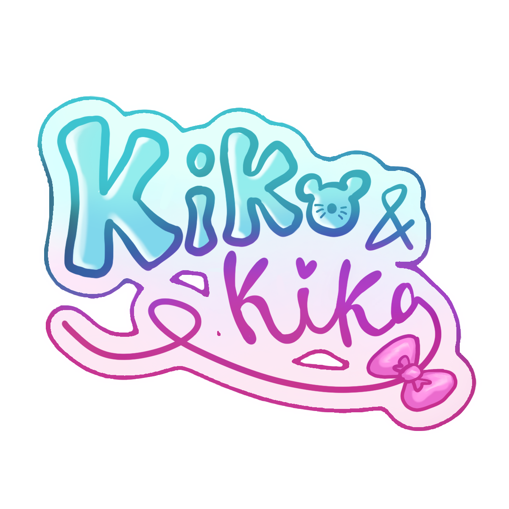
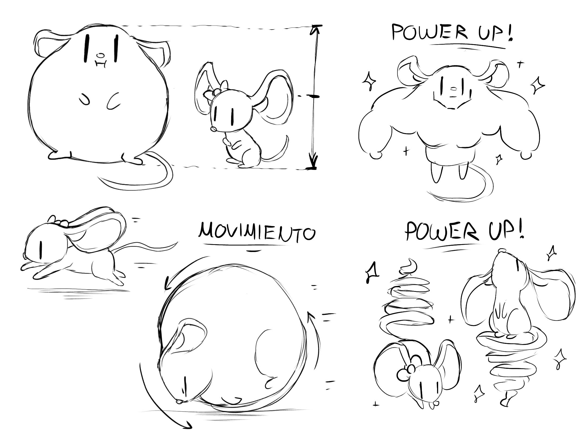
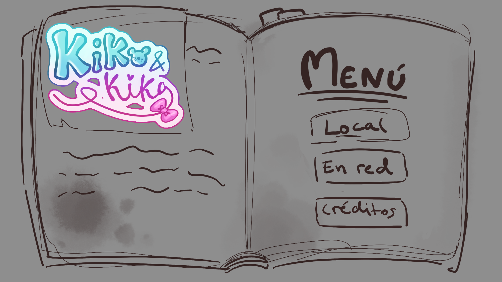
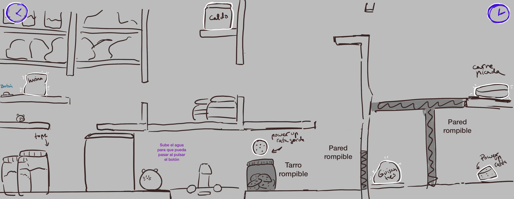
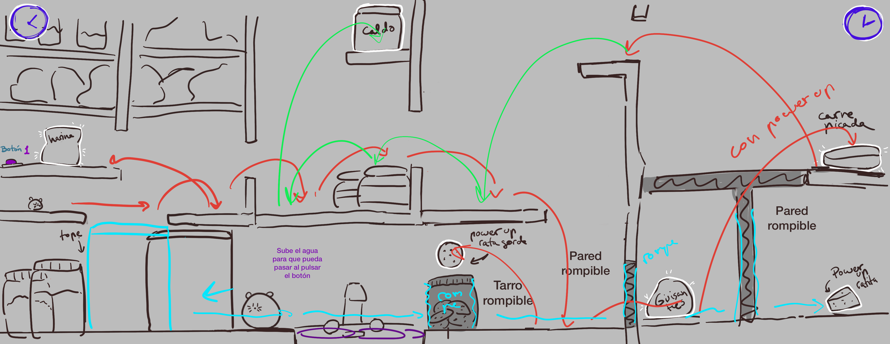
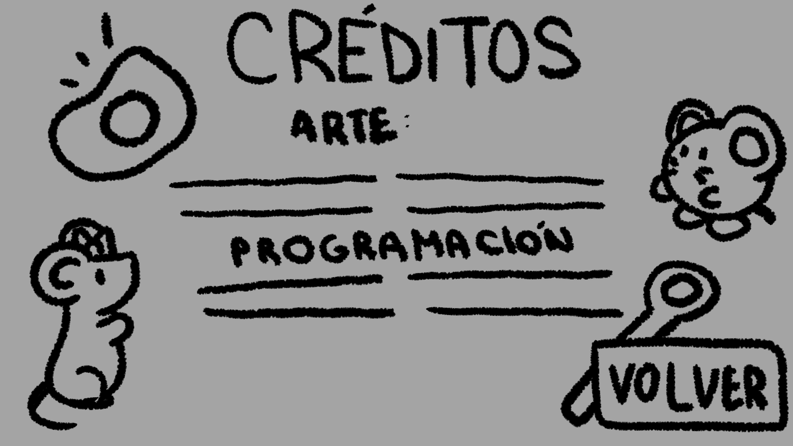
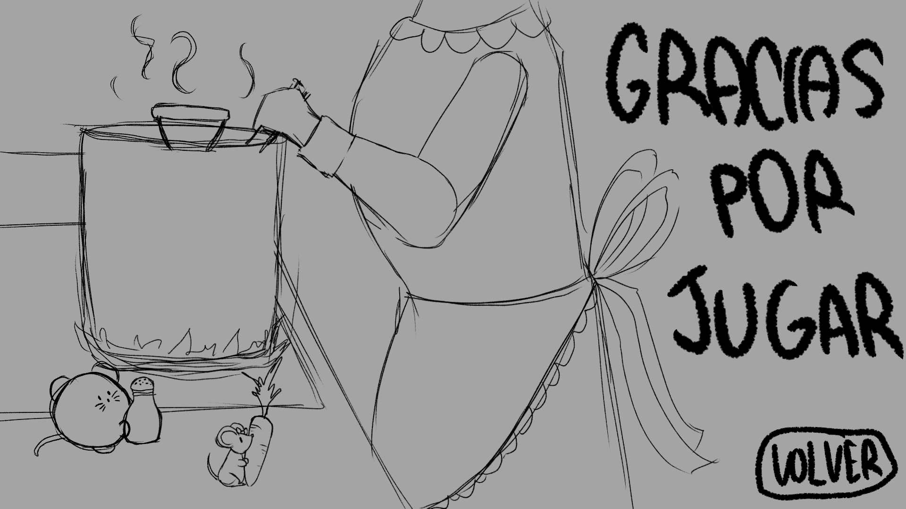
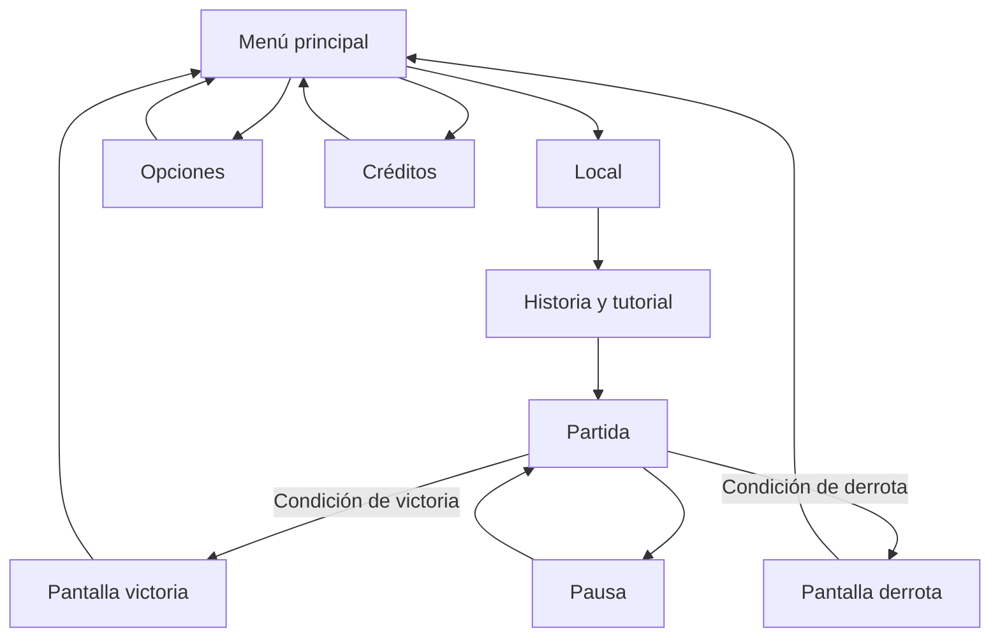

# KIKO Y KIKA- GAME DESIGN DOCUMENT

[← Volver al README](README.md)

**Grupo C** ·  Yi Chen, Sofía García de Vinuesa Castaño, Luisa Baeza Rodríguez, Mireya Vargas Sánchez

*Figura 1. Logo de empresa*

## Índice

1. [Introducción](#1-introducción)
2. [Especificaciones básicas](#2-especificaciones-básicas)
3. [Mecánicas](#3-mecánicas)
4. [Narrativa](#4-narrativa)
5. [Sonido](#5-sonido)
6. [Interfaz y diagrama de flujo](#6-interfaz-y-diagrama-de-flujo)
7. [Comunicación y marketing](#7-comunicación-y-marketing)
8. [Referencias] (#8-referencias)

## 1. Introducción

*Figura 2. Logo del juego*

### 1.1. Concepto principal

Kiko y Kika trata sobre dos ratas cocineras que se ayudan mutuamente para llegar a los diferentes ingredientes que les hacen falta para superar el nivel hasta la meta y terminar la receta.

### 1.2. Características principales

Las características principales del juego serían que dos personajes, Kiko y Kika, tienen que cooperar para poder avanzar por el nivel y así poder superarlo.

### 1.3. Propósito y público objetivo

El principal propósito del juego sería intentar impulsar la comunicación y la cooperación entre
los jugadores para poder superar los niveles en equipo.
El público objetivo serían las personas que disfruten los juegos cooperativos/multijugador.

### 1.4. Estilo visual

El estilo visual del juego se basa en intentar transmitir una estética tierna y graciosa
mediante el diseño de nuestros personajes caricaturizados y unos colores pastel, además, todo el fondo y los niveles estarán
ambientados en una cocina, siendo esta muy grande a comparación de los personajes principales que son
dos ratitas, donde transcurrirá todo el juego.  

## 2. Especificaciones básicas

| Aspecto | Descripción |
| :--- | :--- |
| **Título** | Kiko y Kika |
| **Género** | Juego colaborativo de plataformas
| **Número de jugadores** | 2 (en red, tiempo real) |
| **Público objetivo** | Personas a las que les gusten los juegos colaborativos y multijugador |
| **Clasificación PEGI** | PEGI 3, ya que nuestro juego es apto para todos los públicos y no contiene escenas de violencia o ninguna escena inapropiada |
| **Plataforma** | Navegador web (PC), desarrollado con Phaser 3 |
| **Duración de una partida** | 5-10 minutos dependiendo de la buena/mala colaboración que tengan los jugadores |
| **Representación** | 2D |
| **Licencia** | Apache 2.0 |

## 3. Mecánicas

Haciendo uso de sus habilidades, ambos ratones deberán colaborar en equipo para poder crear una magnífica obra culinaria en la gran cocina, llevando los ingredientes faltantes a la olla de cocción. Haciendo uso del trabajo en equipo y la comunicación entre los jugadores, se deberán de resolver una serie de puzzles para avanzar en los niveles y así completar el juego.

### 3.1. Características

La ratoncita más pequeña (Kika) podrá saltar más alto pero tendrá menos fuerza. Ello permitirá sobrepasar obstáculos altos y entrar por recovecos que se puedan encontrar en el escenario fácilmente.

El ratón más grande (Kiko) tendrá más fuerza pero no podrá saltar más alto. Esto le permitirá empujar bloques pesados o abrir puertas que se puedan presentar en los niveles

### 3.2. Controles

#### Jugador 1 (Kiko)
A: Movimiento hacia la izquierda.
D: Movimiento hacia la derecha.
W: Salto.

#### Jugador 2 (Kika)
←: Movimiento hacia la izquierda.
→: Movimiento hacia la derecha.
↑: Salto.

### 3.3. ¿Cómo completar el nivel?

Ambos jugadores deberán recoger todos los ingredientes del escenario sobrepasando en su camino diversos puzzles y obstáculos a través de sus habilidades. Para completar el nivel, las dos ratitas deberán llegar a la olla final. 

### 3.4. ¿Cómo perder?

Los jugadores tienen un temporizador de 50 segundos para conseguir superar el nivel. Si el temporizador llega a 0, se pierde el nivel.

## 4. Narrativa

### 4.1. Historia

Un día de invierno, la abuela Esperanza cae enferma. Se encuentra en cama todo el día sin nadie que la pueda cuidar. Sin embargo, sus dos ratitas Kiko y Kika deciden cocinarle todos los días hasta que Esperanza se recupere por completo.

### 4.2. Personajes

Los personajes que pueden controlar los usuarios son dos ratitas, cada una con sus propias características y habilidades. Las ratitas Kiko y Kika son dos hermanos que viven en la casa de la abuela Esperanza.

#### KIKO (Jugador 1)

Kiko tiene una composición corporal robusta con un pelaje claro y grueso. Respecto a su personalidad, es un ratón calmado, inteligente y perezoso. Gracias a su gran altura y peso puede mover diversos elementos de la cocina.

#### KIKA (Jugador 2)

Kika es una ratona pequeña con unas orejas grandes. Ella es muy energética y valiente. Gracias a su pequeña altura y ligereza puede entrar en sitios pequeños, correr más rápido y saltar más alto.

*Figura 3. Diseño de personajes de Kiko y Kika*

#### ABUELITA (Personaje secundario)

Esperanza es una persona anciana con el pelo corto rizado y gris. Ella es muy generosa, trabajadora y amante de los animales. Debido al comienzo del frío, cayó enferma sin poder levantarse de la cama.

## 5. Sonido
### 5.1. Música general del juego

Se ha añadido una música de fondo creada por Luisa, una de las integrantes del grupo. Se ha creado una música feliz y adecuada acorde a la estética general del videojuego.

### 5.2. Efectos de sonido

Además se han añadido efectos de sonido para cuando los personajes salten, cuando recogen los alimentos, cuando se hace clic a los botones, cuando pasan de página en el menú de opciones.

## 6. Interfaz y diagrama de flujo

Tipografía: https://www.dafont.com/es/cheese-burger-4.font?l[]=10&l[]=1&text=Men%FA

### 6.1. Pantallas

**Menú principal**

*Figura 4. Menú principal: Inicio del juego, cuenta con el título y 3 botones: (cooperativo local, créditos y opciones)*

**Pantalla de juego (HUD)**

*Figura 5. Pantalla de juego: Se visualiza el nivel/los niveles donde habrá una cámara que se alejará y acercará en función de la posición de los jugadores.*

*Figura 6. Pantalla de juego: Se visualiza el nivel con los alimentos a recoger al igual que la olla final*

**Pantalla de créditos**

*Figura 7. Pantalla créditos: Pantalla donde se muestra el nombre de todos las colaboradoras.*

**Pantalla final victoria**

*Figura 8. Pantalla final: Pantalla donde se ve a la abuelita cocinando con las ratitas.*

**Pantalla final derrota**

*Figura 9. Pantalla final: Pantalla donde se ven platos vacíos.*

**Pantalla historia**

*Figura 10. Pantalla historia: Pantalla donde se cuenta la historia del juego*

**Pantalla tutorial**

*Figura 11. Pantalla tutorial: Pantalla donde se enseñan los controles de los personajes.*

**Pantalla pausa**

*Figura 12. Pantalla pausa: Pantalla donde encontramos dos botones: reanudar y menú.*

**Pantalla opciones**

*Figura 8. Pantalla opciones: Pantalla donde podemos cambiar el volumen a la música y a los efectos de sonido, al igual que cambiar las teclas del juego.*

### 6.2. Diagrama de flujo

## 7. Comunicación y marketing

El juego se publicitará en redes sociales como Instagram o Tiktok. Además de lanzar un kickstarter una vez que el juego haya cogido más popularidad y se subirá a Steam una demo antes de lanzar el juego final.

## 8. Referencias
Hemos cogido las siguientes referencias:
Mati y Pili: https://hiper942.itch.io/mati-pili
Water girl y Fire boy
