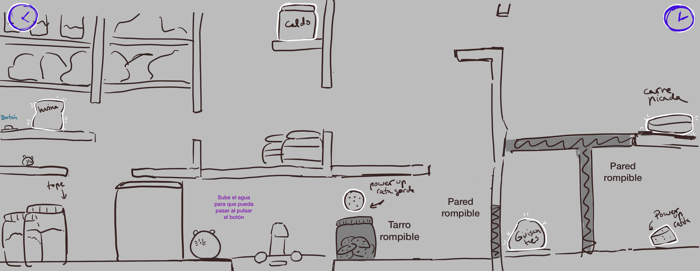
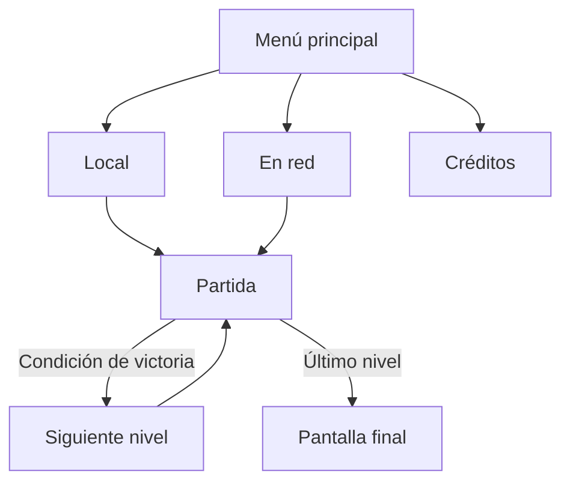

# KIKO Y KIKA- GAME DESING DOCUMENT

[← Volver al README](README.md)

**Grupo C** ·  Yi Chen, Sofía García de Vinuesa Castaño, Luisa Baeza Rodríguez, Mireya Vargas Sánchez 

## Índice

1. [Introducción](#1-introducción)
2. [Especificaciones básicas](#2-especificaciones-básicas)
3. [Mecánicas](#3-mecánicas)
4. [Narrativa](#4-narrativa)
5. [Imagen y diseño visual](#5-imagen-y-diseño-visual)
6. [Sonido](#6-sonido)
7. [Interfaz y diagrama de flujo](#7-interfaz-y-diagrama-de-flujo)
8. [Referencias](#8-referencias)

## 1. Introducción

## 1.1. Concepto principal

Kiko y Kika trata sobre dos ratas cocineras que se ayudan mutuamente para llegar a los diferentes ingredientes que les hacen falta para superar el nivel hasta la meta y terminar la receta. 

## 1.2. Características principales

Las características principales del juego serían que dos personajes, Kiko y Kika, tienen que cooperar para poder avanzar por el nivel y asi poder superarlo.

## 1.3. Propósito y público objetivo

El pricipal propósito del juego sería intentar impulsar la comunicación y la cooperación entre
los jugadores para poder superar los niveles en equipo.
El público objetivo serían las personas que disfruten los juegos cooperativos/multijugador.

## 1.4. Estilo visual

El estilo visual del juego se basa en intentar retrasmitir una estética tierna y graciosa
mediante el diseño de nuestros personajes cariturizados y unos colores pastel, además, todo el fondo y los niveles estarán 
ambientados en una cocina, siendo esta muy grande a comparación de los personajes principales que son 
dos ratitas, donde transcurrirá todo el juego.  

## 2. Especificaciones básicas

| Aspecto | Descripción |
| :--- | :--- |
| **Título** | Kiko y Kika |
| **Género** | Juego colaborativo de plataformas 
| **Número de jugadores** | 2 (en red, tiempo real) |
| **Público objetivo** | Personas a las que les gusten los juegos colaborativos y multijugador |
| **Clasificación PEGI** | PEGI 3, ya que nuestro juego es apto para todos los públicos y no contiene escenas de violencia o ninguna escena inapropiada |
| **Plataforma** | Navegador web (PC), desarrollado con Phaser 3 |
| **Duración de una partida** | 5-10 minutos dependiendo de la buena/mala colaboración que tengan los jugadores |
| **Representación** | 2D |
| **Licencia** | Apache 2.0 |

## 3. Mecánicas

Haciendo uso de sus habilidades, ambos ratones deberán colaborar en equipo para poder crear una magnífica obra culinaria en la gran cocina, llevando los ingredientes faltantes a la olla de cocción. Haciendo uso del trabajo en equipo y la comunicación entre los jugadores, se deberán de resolver una serie de puzzles para avanzar en los niveles y así completar el juego.

## 3.1. Características

La ratoncita más pequeña (Kika) podrá saltar más alto pero tendrá menos fuerza. Ello permitirá sobrepasar obstáculos altos y entrar por recovecos que se puedan encontrar en el escenario fácilmente.

El ratón más grande (Kiko) tendrá más fuerza pero no podrá saltar más alto. Esto le permitirá empujar bloques pesados o abrir puertas que se puedan presentar en los niveles

## 3.2. Controles

Ambos ratones serán controlados con las teclas A, D, SPACE del teclado en cada dispositivo.

A: Movimiento hacia la izquierda.
D: Movimiento hacia la derecha.
SPACE: Salto.

## 3.3. ¿Cómo completar el nivel?

Ambos jugadores deberán introducir en la olla situada al final del nivel los ingredientes del escenario sobrepasando en su camino diversos puzzles y obstáculos a través de sus habilidades.

## 3.4. PowerUps

Cuando Kika consume un powerUp, adquiere la habilidad de saltar mucho más alto, ello durará un tiempo limitado dentro del escenario.

Cuando Kiko consume un powerUp, adquiere la habilidad de romper los obstáculos en su camino, ello durará un tiempo limitado dentro del escenario.

## 4. Narrativa

### 4.1. Historia

Un día de invierno, la abuela Esperanza cae enferma. Se encuentra en cama tood el día sin nadie que la pueda cuidar. Sin embargo, sus dos ratitas Kiko y Kika deciden cocinarle todos los días hasta que Esperanza se recupere por completo.

### 4.2. Personajes

Los personajes que pueden controlar los usuarios son dos ratitas, cada una con sus propias características y habilidades. Las ratitas Kiko y Kika son dos hermanos que viven en la casa de la abuela Esperanza.

#### KIKO (Jugador 1)

Kiko tiene una composición corporal robusta con un pelaje claro y grueso. Respecto a su personalidad, es un ratón calmado, inteligente y perezoso. Gracias a su gran altura y peso puede mover diversos elementos de la cocina.

#### KIKA (Jugador 2)

Kika es una ratona pequeña con unas orejas grandes. Ella es muy energética y valiente. Gracias a su pequeña altura y ligereza puede entrar en sitios pequeños, correr más rápido y saltar más alto.

#### ABUELITA (Personaje secundario)

Esperanza es una persona anciana con el pelo corto rizado y gris. Ella es muy generosa, trabajadora y amante de los animales. Debido al comienzo del frío, cayó enferma sin poder levantarse de la cama.

## 7. Interfaz y diagrama de flujo

### 7.1. Pantallas

**Menú principal**

*Figura 6. Menú principal: Inicio del juego, cuenta con el título y 3 botones: (cooperativo local, cooperativo online y créditos)*

**Pantalla de juego (HUD)**

*Figura 7. Pantalla de juego: Se visualiza el nivel/los niveles, hay dos cámaras, una para cada jugador*

**Pantalla de créditos**

*Figura 8. Pantalla créditos: Pantalla donde se muestra el nombre de todos las colaboradoras con sus funciones y todas las referencias usadas.*

**Pantalla final**

*Figura 8. Pantalla final: Pantalla donde se ve a la abuelita cocinando con las ratitas.*

### 7.2. Diagrama de flujo

