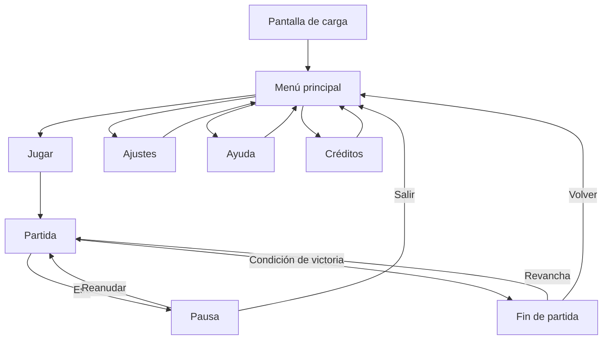

# KIKO Y KIKA- GAME DESING DOCUMENT

[← Volver al README](README.md)

**Grupo C** ·  Yi Chen, Sofía García de Vinuesa Castaño, Luisa Baeza Rodríguez, Mireya Vargas Sánchez 

## Índice

1. [Introducción](#1-introducción)
2. [Especificaciones básicas](#2-especificaciones-básicas)
3. [Jugabilidad](#3-jugabilidad)
4. [Narrativa](#4-narrativa)
5. [Imagen y diseño visual](#5-imagen-y-diseño-visual)
6. [Sonido](#6-sonido)
7. [Interfaz y diagrama de flujo](#7-interfaz-y-diagrama-de-flujo)
8. [Comunicación y marketing](#8-comunicación-y-marketing)
9. [Referencias](#9-referencias)

## 1. Introducción

## 1.1. Concepto principal

Kiko y kika trata sobre dos ratas cocineras que se ayudan mutuamente para llegar a los 
diferentes ingredientes que les hacen falta para superar el nivel hasta la meta y terminar la receta. 

## 1.2. Características principales

Las características principales del juego serían que dos personajes, Kiko y Kika, 
tienen que cooperar para poder avanzar por el nivel y asi poder superarlo.

## 1.3. Propósito y público objetivo

El pricipal propósito del juego sería intentar impulsar la comunicación y la cooperación entre
los jugadores para poder superar los niveles en equipo.
El público objetivo serían las personas que disfruten los juegos cooperativos/multijugador.

## 1.4. Estilo visual

El estilo visual del juego se basa en intentar retrasmitir una estética tierna y graciosa
mediante el diseño de nuestros personajes cariturizados y unos colores pastel, además, todo el fondo y los niveles estarán 
ambientados en una cocina, siendo esta muy grande a comparación de los personajes principales que son 
dos ratitas, donde transcurrirá todo el juego.  

## 2. Especificaciones básicas

> *Rúbrica — Documento / Especificaciones básicas:* género, público objetivo/edad y plataforma.

| Aspecto | Descripción |
| :--- | :--- |
| **Título** | AAA |
| **Género** | Juego colaborativo de plataformas 
| **Número de jugadores** | 2 (en red, tiempo real) |
| **Público objetivo** | Personas a las que les gusten los juegos colaborativos y multijugador |
| **Clasificación PEGI** | PEGI 3, ya que nuestro juego es apto para todos los públicos y no contiene escenas de violencia o ninguna escena inapropiada |
| **Plataforma** | Navegador web (PC), desarrollado con Phaser 3 |
| **Duración de una partida** | 5-10 minutos dependiendo de la buena/mala colaboración que tengan los jugadores |
| **Representación** | 2D |
| **Licencia** | Apache 2.0 |

---

## 7. Interfaz y diagrama de flujo

### 7.1. Pantallas

**Menú principal**

*Figura 6. Menú principal: Inicio del juego, cuenta con el título y 3 botones: (cooperativo local, cooperativo online y créditos)*

**Pantalla del mapa**

*Figura 6. Mapa: Los niveles se muestras en un libro de recetas que funciona como mapa de niveles*

**Pantalla de juego (HUD)**

*Figura 7. Pantalla de juego: Se visualiza todo el nivel nada más entrar al juego, la cámara es fija*

**Pantalla de créditos**

*Figura 8. Pantalla créditos: Pantalla donde se muestra el nombre de todos las colaboradoras con sus funciones y todas las referencias usadas.*

### 7.2. Diagrama de flujo

> *Rúbrica — Documento / Diagrama de flujo.* Podéis usar Mermaid (GitHub lo renderiza directamente) o una imagen exportada.

**Opción 1 — Mermaid** (se dibuja automáticamente en GitHub):

**Opción 2 — Imagen** exportada desde draw.io, Excalidraw, Figma...:

*Figura 9. Diagrama de flujo entre pantallas.*

## 8. Interfaz y diagrama de flujo
